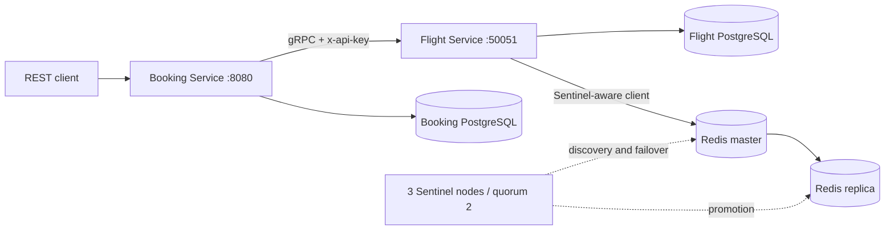

# Распределённая система бронирования авиабилетов

Booking Service предоставляет REST API, Flight Service управляет рейсами и местами
через gRPC. У сервисов отдельные PostgreSQL. Flight Service использует Redis
Cache-Aside с автоматическим переключением мастера через Sentinel.

## Запуск

Требуются Docker Engine и Docker Compose v2+:

```bash
docker compose up --build
```

API: [http://localhost:8080](http://localhost:8080), Swagger:
[http://localhost:8080/docs](http://localhost:8080/docs).
Миграции и демонстрационные рейсы применяются автоматически до запуска серверов.
Для запуска в фоне с проверкой готовности: `make up`.

Параметры можно задать через `.env` (пример — `.env.example`). По умолчанию используются
локальные демонстрационные credentials. Наружу опубликован только порт REST API;
PostgreSQL, Redis, Sentinel и gRPC доступны внутри Compose-сети.

Для другого HTTP-порта: `HOST_PORT=18080 docker compose up --build`.
Остановка с сохранением данных: `docker compose down`.

## Архитектура



Контракт: [`proto/flight.proto`](proto/flight.proto). Python-модули сгенерированы
`grpc_tools.protoc`, включены в репозиторий и повторно генерируются при сборке образа.
`make proto` обновляет их локально. Даты — `google.protobuf.Timestamp`, статусы — enum.
Все даты трактуются в UTC. День рейса определяется по дате вылета в UTC.

Схема данных и последовательности: [`docs/architecture.md`](docs/architecture.md).

## REST API

Все денежные значения — целые копейки RUB: `price_minor`, `total_price_minor`.
UUID используются для рейсов и бронирований, `user_id` — строка до 128 символов.

| Метод | Назначение |
|---|---|
| `GET /flights?origin=SVO&destination=LED&date=2026-12-01` | Рейсы SCHEDULED; дата необязательна |
| `GET /flights/{id}` | Информация о рейсе |
| `POST /bookings` | Получить цену, зарезервировать места, создать CONFIRMED |
| `GET /bookings/{id}` | Бронирование по ID |
| `GET /bookings?user_id=X` | Бронирования пользователя |
| `POST /bookings/{id}/cancel` | Вернуть места и установить CANCELLED |
| `GET /health` | Liveness |
| `GET /ready` | Готовность Booking Service и его БД |

Пример полного сценария:

```bash
curl 'http://localhost:8080/flights?origin=SVO&destination=LED&date=2026-12-01'

curl -X POST http://localhost:8080/bookings \
  -H 'Content-Type: application/json' \
  -H 'Idempotency-Key: aaaaaaaa-aaaa-4aaa-8aaa-aaaaaaaaaaaa' \
  -d '{
    "user_id": "user-1",
    "flight_id": "11111111-1111-4111-8111-111111111111",
    "passenger_name": "Иван Иванов",
    "passenger_email": "ivan@example.com",
    "seat_count": 2
  }'

curl http://localhost:8080/bookings/aaaaaaaa-aaaa-4aaa-8aaa-aaaaaaaaaaaa
curl 'http://localhost:8080/bookings?user_id=user-1'
curl -X POST http://localhost:8080/bookings/aaaaaaaa-aaaa-4aaa-8aaa-aaaaaaaaaaaa/cancel
```

При первой покупке двух мест на SU1234 стоимость — `1100000` копеек (11 000 RUB).
Демонстрационные рейсы: SVO → LED 1 и 2 декабря 2026, VKO → LED 1 декабря 2026.

Заголовок `Idempotency-Key` необязателен; это UUID будущего бронирования.
Повтор с тем же телом возвращает то же бронирование без повторного списания мест.
Другое тело с тем же ключом даёт 409. После неудачной попытки с начатым
резервированием используйте новый ключ. Повтор отмены возвращает CANCELLED и не
увеличивает остаток второй раз.

| Ошибка gRPC | HTTP |
|---|---|
| INVALID_ARGUMENT | 400 |
| NOT_FOUND | 404 |
| RESOURCE_EXHAUSTED / FAILED_PRECONDITION / ALREADY_EXISTS | 409 |
| UNAVAILABLE, открытый circuit breaker | 503 |
| DEADLINE_EXCEEDED после исчерпания попыток | 504 |
| UNAUTHENTICATED / PERMISSION_DENIED между сервисами | 502 |

Ошибки формата REST-запроса возвращают 422. Межсервисный API key не является
аутентификацией конечных пользователей: `user_id` задаётся клиентом согласно заданию.

## Транзакции и восстановление

Flight Service сериализует операции одного `booking_id` advisory lock, блокирует
рейс через `SELECT FOR UPDATE` и в одной транзакции изменяет остаток, резервацию и
версию кеша. UNIQUE по `booking_id` и проверка параметров обеспечивают
идемпотентность ReserveSeats, в том числе при параллельных повторах.

Booking Service сначала вызывает GetFlight и запоминает цену, затем фиксирует
служебный intent в `booking_attempts`, вызывает ReserveSeats и одной локальной
транзакцией создаёт Booking и завершает intent. При ошибке ReserveSeats Booking не
создаётся. При ошибке локальной записи выполняется компенсирующий ReleaseReservation.
Снимок `total_price_minor = seat_count * GetFlight.price_minor` не меняется после
изменения цены рейса.

Две PostgreSQL не образуют общую ACID-транзакцию. Поэтому при потере связи или
остановке процесса возврат мест может быть отложен: durable intents и recovery
worker завершают компенсацию после восстановления Flight Service. Незавершённые
попытки старше `RECOVERY_STALE_SECONDS` компенсируются; подтверждённые бронирования
не затрагиваются. Intent блокируется на время создания, worker использует
`FOR UPDATE SKIP LOCKED`. Исход неопределённого COMMIT проверяется по сохранённому
состоянию перед компенсацией.

ReleaseReservation сохраняет tombstone даже для ещё не существующей резервации:
запоздавший ReserveSeats после отмены завершится FAILED_PRECONDITION. Это закрывает
гонку «дедлайн клиента истёк, но сервер ещё исполняет запрос». Отмена имеет отдельный
durable intent: сбой между возвратом мест и обновлением Booking будет исправлен
worker. Во время восстановления незавершённая отмена может временно отображаться
как CONFIRMED; после восстановления зависимости становится CANCELLED.

## Кеш и Redis Sentinel

Redis master + replica + **три Sentinel**, quorum 2. Клиент redis-py использует
`Sentinel.master_for`, а не фиксированный адрес мастера. При недоступности Redis
Flight Service продолжает чтение из PostgreSQL; Redis не является хранилищем мест.

Cache-Aside: cache lookup → miss → SELECT → SET с TTL (300–600 секунд).
Ключи: `flight:{id}:v{revision}` и
`search:{origin}:{destination}:{date|all}:v{revision}`. Hit/miss и ошибки видны в логах.

ReserveSeats, ReleaseReservation и UpdateFlight увеличивают общую версию кеша
в той же PostgreSQL-транзакции. Чтение сначала получает версию из PostgreSQL.
Старые ключи становятся недоступны и удаляются по TTL. Такая логическая инвалидация
защищает и от запоздавшего SET после мутации, и от возврата старого содержимого
реплики при failover, и от ошибки Redis во время мутации. Cache hit экономит запрос
к таблице рейсов, но сохраняет короткий запрос версии в PostgreSQL. Общая версия
выбрана ради корректности и простоты учебной системы; любая мутация инвалидирует
все кешированные рейсы и поисковые выборки.

UpdateFlight позволяет менять цену, вместимость и статус через gRPC. Вместимость
нельзя уменьшить ниже числа уже занятых мест. Аутентификация обязательна для всех RPC.

## Retry и circuit breaker

Реализованы в клиентском gRPC interceptor, вне бизнес-логики:

- максимум **3 попытки суммарно**, паузы 100 и 200 мс по умолчанию;
- повторяются только UNAVAILABLE и DEADLINE_EXCEEDED, каждая попытка имеет дедлайн;
- CLOSED → OPEN после 5 последовательных неудачных логических вызовов в окне 30 с;
- OPEN немедленно возвращает HTTP 503 без сетевого вызова;
- через 15 с HALF_OPEN пропускает один пробный логический вызов; успех закрывает
  breaker, сбой снова открывает;
- параллельные результаты старого состояния не закрывают уже открытый breaker;
- бизнес-ошибки не считаются отказом зависимости; переходы состояний логируются.

| Переменная | По умолчанию |
|---|---|
| `GRPC_API_KEY` | локальный демонстрационный ключ |
| `GRPC_MAX_ATTEMPTS` | 3 (допустимо 1–3) |
| `GRPC_TIMEOUT_SECONDS` | 2 |
| `GRPC_RETRY_BACKOFF_SECONDS` | 0.1 |
| `CB_FAILURE_THRESHOLD` | 5 |
| `CB_RESET_TIMEOUT_SECONDS` | 15 |
| `CB_WINDOW_SECONDS` | 30 |
| `CACHE_TTL_SECONDS` | 300 (допустимо 300–600) |
| `RECOVERY_STALE_SECONDS` | 60 |
| `RECOVERY_INTERVAL_SECONDS` | 5 |

Flight Service получает `DATABASE_URL`, `REDIS_SENTINELS`, `REDIS_MASTER_NAME`,
`GRPC_API_KEY`; Booking Service — собственный `DATABASE_URL` и `FLIGHT_GRPC_TARGET`.
Все credentials передаются окружением контейнеров. Мигратор хранит версии и SHA256,
проверяет изменение уже применённых файлов, защищён advisory lock.

## Проверки

```bash
make install          # Python 3.13, uv, точные версии из requirements-dev.txt
make lint
make test             # unit: retry, breaker, API, кеш, реальный gRPC transport
make integration      # поднимает стек и запускает все тесты в контейнере
```

Интеграционные тесты используют две настоящие PostgreSQL, gRPC, Redis и REST:
конкуренция за последнее место, параллельные повторы, ограничения контрактов,
фиксация цены, инвалидация кеша, потерянный ответ, ошибка INSERT и восстановление
после сбоя между операциями. Создаются отдельные тестовые рейсы.

Проверка реального отключения Redis master и Flight Service на локальном стенде:

```bash
.venv/bin/python scripts/fault_checks.py --base-url http://localhost:8080
```

Скрипт временно останавливает контейнеры текущего Compose-проекта, проверяет
Sentinel promotion и восстановление circuit breaker, затем запускает остановленные
контейнеры обратно. Предназначен для локального демонстрационного стенда.
