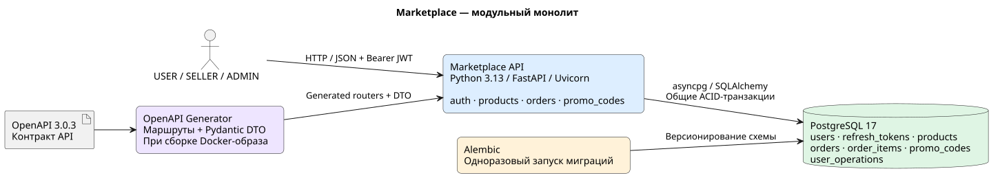

# Marketplace: OpenAPI + CRUD

Домашнее задание №2: контрактный API маркетплейса с товарами, заказами,
промокодами, JWT и ролями USER / SELLER / ADMIN. Реализованы все десять пунктов задания.

Стек: Python 3.13, FastAPI, uv, Pydantic, async SQLAlchemy + asyncpg,
PostgreSQL 17, Alembic, PyJWT, Argon2, structlog, pytest и HTTPX.
Версии Python-зависимостей закреплены в `uv.lock`.
Использование Alembic вместо Flyway/Liquibase согласовано с преподавателем.

## Запуск

Достаточно Docker с Compose plugin:

```bash
docker compose up --build
```

Compose поднимает PostgreSQL, выполняет `alembic upgrade head` отдельным
процессом `migrate`, затем запускает API. Генерация API и DTO выполняется
внутри Docker-сборки. Локально устанавливать Python, Java или uv для этого не нужно.

- API: http://localhost:8080
- Swagger UI: http://localhost:8080/docs
- Исходный контракт: http://localhost:8080/openapi.json
- PostgreSQL: `localhost:15432`, БД / пользователь / пароль: `marketplace`
- Демонстрационный администратор: `admin` / `Admin-password-123`

Эти учетные данные предназначены для локальной защиты. Настройки переопределяются
переменными окружения; образец находится в `.env.example`.
Администратор создаётся при запуске только при заданном `BOOTSTRAP_ADMIN_PASSWORD`.
Публичная регистрация позволяет выбрать только USER или SELLER. Повторный запуск
не сбрасывает пароль и роль существующего аккаунта.

Фоновый запуск, логи и остановка:

```bash
make up
docker compose logs -f api migrate
make down
```

`down` сохраняет данные в именованном томе. Порты можно изменить через `HOST_PORT`,
`DB_PORT` и `TEST_DB_PORT`.

## Проверка и защита

После запуска приложения:

```bash
make e2e
```

Сценарий использует HTTP через опубликованный порт и выполняет реальные `SELECT`
через `docker compose exec db psql`. Проверяет регистрацию и вход, доступы,
валидацию, создание заказа со скидкой, снимок цены, пересчёт и снятие промокода,
переходы состояний, отмену, возврат остатков, архивирование и ротацию refresh.
Токены и пароли в вывод не попадают. При каждом запуске создаются отдельные
демонстрационные пользователи и товары; предыдущие данные не удаляются.

Все интеграционные тесты в контейнере:

```bash
make test
```

Тесты используют отдельную БД `marketplace_test` в сервисе `test-db`, миграции
Alembic и настоящие транзакции PostgreSQL. Включены конкурентные запросы за
последний товар, последнее использование промокода, создание активного заказа,
обновление и отмена. Данные основной БД тесты не затрагивают. Запуск pytest
отказывается очищать БД, если её имя не заканчивается на `_test`.

Интерактивный SQL:

```bash
make sql
```

Например:

```sql
SELECT id, name, price, stock, status, seller_id, created_at, updated_at FROM products;
SELECT id, user_id, status, promo_code_id, total_amount, discount_amount FROM orders;
SELECT order_id, product_id, quantity, price_at_order FROM order_items;
SELECT code, current_uses, max_uses, active FROM promo_codes;
SELECT user_id, operation_type, created_at FROM user_operations ORDER BY created_at;
```

Порядок демонстрации и вопросы для подготовки — в [docs/defense.md](docs/defense.md).

## Контракт и кодогенерация

Источник API — [openapi/marketplace.yaml](openapi/marketplace.yaml), OpenAPI 3.0.3.
Сначала меняется контракт, затем генерируются маршруты и модели.
Ручных транспортных DTO в приложении нет. ORM-модели и внутренний контекст
авторизации — собственные объекты приложения, они не заменяют DTO.

```bash
make generate
```

Для локальной генерации нужны Java 21+, curl и sha256sum. Скрипт скачивает
OpenAPI Generator **7.16.0**, проверяет SHA-256, валидирует спецификацию и
генерирует пакет `marketplace_api` в `generated/src`.
Каталог `generated/` игнорируется Git и пересоздаётся целиком.
Общая команда сборки приложения — `make build` — запускает ту же генерацию в Docker.

Генерируются:

- маршруты FastAPI с путями, методами, параметрами, схемами и HTTP-кодами;
- Pydantic DTO запросов, ответов, ошибок и enum;
- ограничения полей из контракта.

В репозитории хранятся конфигурация и небольшие собственные Mustache-шаблоны
в `codegen/`. Они устраняют особенности стандартного python-fastapi-генератора:

- обязательное тело — `Body(...)`, а не `Body(None)`;
- успешный HTTP-код берётся из `x-success-status`;
- JSON query-параметры преобразуются из строк, целочисленные поля тела остаются строгими;
- денежные поля с `format: decimal` и `x-money` используют `Decimal`, а не float;
- `date-time` с `x-timezone` требует часовой пояс;
- запрещаются дополнительные поля и null для non-nullable полей;
- маршруты получают AsyncSession и пользователя через Depends и вызывают `app.handlers`.

Сгенерированные маршруты непосредственно подключаются в `app/main.py`.
`app/handlers.py` содержит тонкие адаптеры к бизнес-сервисам. Сгенерированные
базовые классы из стандартного набора файлов не используются.
Swagger UI показывает исходный контракт, включая ограничения ролей и каталог ошибок.

## Архитектура

Модульный монолит: один процесс API, одна БД, модули `auth`, `products`,
`orders`, `promo_codes`. Предыдущее микросервисное разбиение из домашнего задания №1
заменено на общий транзакционный контур: резервирование остатков, запись заказа,
промокода и операции пользователя должны быть атомарны.



```text
openapi/marketplace.yaml
       │ OpenAPI Generator
       ▼
generated/src/marketplace_api     маршруты + DTO
       │
       ▼
app/handlers.py                   адаптеры HTTP
       │
       ├── auth/service.py        пользователи, пароли, токены
       ├── products/service.py    каталог и владельцы товаров
       ├── orders/service.py      транзакции и состояния заказов
       └── promo_codes/service.py промокоды и расчёт скидки
                │
                ▼
       SQLAlchemy AsyncSession → PostgreSQL
```

Сервисы владеют границами транзакций. Обработчики HTTP и вспомогательные функции
не выполняют независимых commit. В заказе все изменения используют одну сессию.
Отдельная короткая сессия авторизации не участвует в бизнес-транзакции.

## Транзакции и конкурентные запросы

Операции заказа блокируют строки в общем порядке:

1. Пользователи: действующий пользователь и владелец заказа, по UUID.
2. Существующий заказ.
3. Все затронутые товары, по UUID.
4. Применяемый промокод.

`SELECT ... FOR UPDATE` сериализует конкурирующие изменения. Блокировка
существующей строки пользователя защищает проверки cooldown и первого активного
заказа даже при отсутствии предыдущих заказов и операций. Частичный уникальный
индекс дополнительно запрещает два заказа CREATED / PAYMENT_PENDING на пользователя.

При обновлении блокируется объединение старых и новых товаров, возвращаются старые
остатки, проверяются и резервируются новые, заменяются позиции и пересчитывается
стоимость. Любая ошибка откатывает также возврат старых остатков.

В БД есть FK, CHECK-ограничения, уникальные коды промоакций, индекс `products.status`
и индекс истории операций. `created_at` заполняется default, `updated_at` у товаров
и заказов — триггером, включая изменения напрямую через SQL. Время хранится в
`timestamptz`. DELETE переводит товар в ARCHIVED и сохраняет строку.

## Принятые бизнес-решения

В присланном задании некоторые случаи описаны неоднозначно. Приняты следующие правила:

- Процентная скидка от 0 до 70% включительно применяется; при значении **свыше 70%**
  товар оплачивается полностью. Это буквальное прочтение «в ином случае цена 100%».
  Входное значение скидки должно быть больше 0 и не больше 100.
- На обновлении промокод проверяется заново. Если он истёк, отключён или сумма
  ниже минимальной, скидка снимается и использование возвращается. Уже занятый
  этим заказом слот считается собственным: при `current_uses == max_uses` сохранять
  скидку можно; повторного инкремента нет.
- Дубли product_id в items отклоняются валидацией до бизнес-логики.
- При обновлении все новые позиции получают текущие цены. Изменение товара само
  по себе никогда не изменяет существующий заказ.
- Отмена допускается из CREATED и PAYMENT_PENDING, включая исключение
  CREATED → CANCELED, явно указанное в описании отмены.
- Для полной модели состояний добавлен `POST /orders/{id}/status`. USER может
  отправить собственный заказ в PAYMENT_PENDING; дальнейшие переходы подтверждает
  ADMIN. Пропуски, повторения и обратные переходы запрещены. Отмена — отдельный метод.
- ADMIN может читать, обновлять и отменять чужие заказы согласно матрице доступа.
  При создании владельцем становится сам вызывающий пользователь.
- CREATE_ORDER и UPDATE_ORDER имеют независимые cooldown по действующему
  пользователю, в том числе при действиях ADMIN. Успешные операции фиксируются;
  неуспешные не расходуют лимит. `ORDER_COOLDOWN_MINUTES=1` по умолчанию,
  `0` отключает ожидание. При 429 возвращается Retry-After.
- GET товаров включает все статусы, в том числе ARCHIVED. Фильтр category точный
  и чувствительный к регистру; порядок выдачи стабилен по created_at и id.
- Промокоды общие для маркетплейса, поскольку привязки к продавцу в задании нет.
- Деньги: Decimal / NUMERIC(12,2), не более двух знаков, округление скидки
  ROUND_HALF_UP до копеек. Тело JSON разбирается с сохранением Decimal.
  Ответы содержат JSON numbers. Суммы сверх вместимости NUMERIC отклоняются.
- Размер страницы от 1 до 100, по умолчанию 20; page начинается с 0.
  Остаток ограничен PostgreSQL INTEGER. При редактировании оставляется место
  для возврата всех резервов, которые ещё могут быть отменены.

## Ошибки, безопасность и логи

Ошибки имеют `{error_code, message, details}`. Валидация возвращает
`400 VALIDATION_ERROR`, а `details.fields` перечисляет пути и нарушения.
Невалидный UUID, JSON, enum, пропущенное тело или лишнее поле не доходят до обработчика.
Все бизнес-коды и HTTP-статусы описаны в OpenAPI.

Access JWT действует 20 минут, refresh JWT — 14 дней. Проверяются подпись, алгоритм,
issuer, audience, exp и тип токена. Роль присутствует в claim `role`, при запросе
актуальная роль дополнительно читается из БД. Пароли хешируются Argon2.
Refresh-токены хранятся в виде SHA-256-хеша и ротируются с блокировкой строки:
из двух параллельных обновлений успешным будет одно.

Каждый HTTP-запрос имеет JSON completion-лог с request_id, method, endpoint,
status_code, duration_ms, user_id и timestamp. UUID генерируется сервером и
возвращается в X-Request-Id, включая ошибки. Для POST / PUT / DELETE логируется
request_body. Пароли, токены и вложенные чувствительные поля маскируются;
невалидный JSON и слишком большие тела не записываются целиком. Логи не зависят
от OpenTelemetry. Стандартные сообщения приложения также форматируются как JSON.

## Локальная разработка

```bash
uv sync --frozen
make generate
docker compose up -d --wait db
PYTHONPATH=generated/src uv run alembic upgrade head
PYTHONPATH=generated/src uv run python -m app.main
```

Установка зависимостей использует Python 3.13 из `.python-version`.
Настройки для локального запуска можно скопировать из `.env.example` в `.env`.

```bash
make test-local
make lint
PYTHONPATH=generated/src uv run alembic check
```

Новая миграция после изменения ORM-моделей:

```bash
PYTHONPATH=generated/src uv run alembic revision --autogenerate -m 'describe change'
```

Сгенерированную миграцию нужно проверить вручную. Приложение не использует
`metadata.create_all()` для создания схемы.
