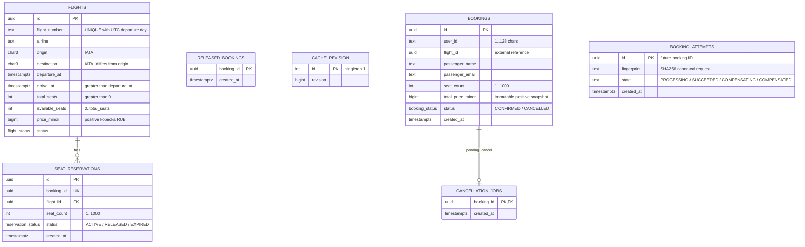
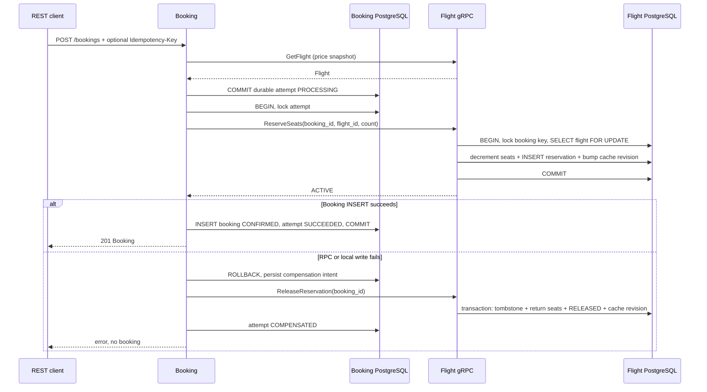
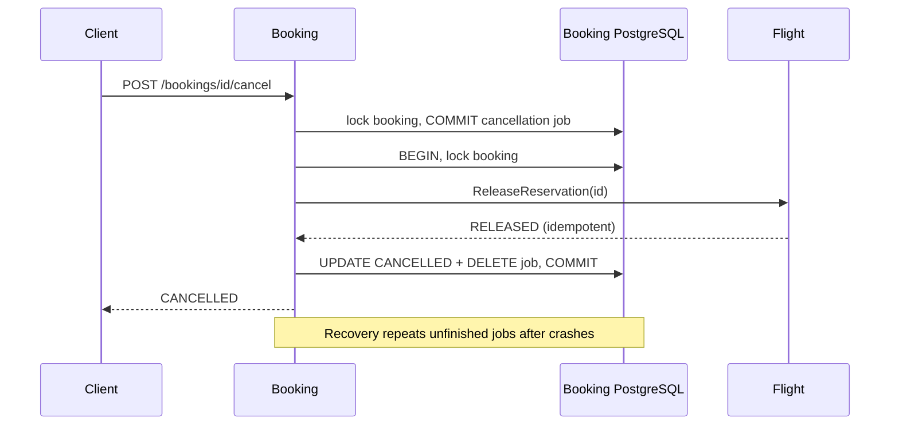

# Схема данных и протокол согласования

## ER-диаграмма (Mermaid)

Две базы, без внешних ключей между сервисами. `Booking.flight_id` и
`SeatReservation.booking_id` — ссылки по контракту gRPC.

`flights`, `seat_reservations`, `released_bookings`, `cache_revision` принадлежат
Flight PostgreSQL. Остальные таблицы — Booking PostgreSQL. Ограничения реализованы
в SQL, а не только в валидации HTTP/gRPC.

Все бизнес-атрибуты зависят от ключа своей сущности; повторяющихся групп и
транзитивных зависимостей между неключевыми бизнес-атрибутами нет. Данные пассажира
относятся к конкретному бронированию, отдельной сущности «профиль пользователя»
нет. Стоимость бронирования — исторический факт, не ссылка на изменяемую цену рейса.
Дата вылета не хранится отдельным атрибутом: уникальный expression index по
`flight_number` и `(departure_at AT TIME ZONE 'UTC')::date` обеспечивает
уникальность номера рейса в пределах дня без избыточного поля. Доступный остаток — транзакционно поддерживаемый
счётчик; его границы защищены CHECK и блокировкой рейса.

## Создание и компенсация

При недоступности Flight компенсация остаётся в БД и повторяется recovery worker.
При падении Booking до сохранения COMPENSATING worker находит старый PROCESSING.
Блокировка intent исключает конкуренцию worker с активным созданием. При
неопределённом результате COMMIT проверяется SUCCEEDED, поэтому успешная покупка
не компенсируется.

## Отмена

## Пределы модели

Синхронной распределённой транзакции нет. Во время отказа возможна временная
резервация без подтверждённого Booking; восстановление возвращает эти места.
Гарантия итоговой согласованности требует сохранности PostgreSQL и последующего
восстановления доступности сервисов. Резервации подтверждённых бронирований не
истекают автоматически; EXPIRED предусмотрен enum контракта, отдельная политика
временных удержаний заданием не требуется.

После смены статуса рейса существующие бронирования сохраняются. UpdateFlight
не запускает массовые возвраты: эта бизнес-операция не входит в заданный API.
