# Архитектура и точки отказа

```mermaid
flowchart LR
    HTTP[HTTP clients] --> Movie[Movie Service / FastAPI]
    Generator[Historical + live generator] --> Movie
    Movie -->|user_id key · Avro · acks=all| Kafka
    subgraph Kafka[Kafka KRaft cluster]
        B1[broker/controller 1]
        B2[broker/controller 2]
        B3[broker/controller 3]
    end
    Registry[Schema Registry · Avro v1/v2] -.schema ID.-> Movie
    Registry -.writer schema.-> Engine
    Kafka -->|3 partitions · RF=3 · minISR=2| Engine[ClickHouse Kafka Engine]
    Engine --> MV[Materialized Views]
    MV --> Raw[raw_events / MergeTree]
    MV --> DLQ[ingestion_errors / MergeTree]
    Raw --> Unique[events · dedup by event_id]
    Unique -->|SQL · consistent ingestion cutoff| Agg[Aggregation Service]
    Schedule[Configurable scheduler / manual HTTP] --> Agg
    Agg --> Snapshots[CH snapshots + commit marker]
    Snapshots --> Latest[daily_metrics view]
    Latest --> Grafana[Grafana · cohort heatmap + 5 panels]
    Agg -->|transaction · replace date| PG[(PostgreSQL metrics + export_jobs)]
    PG --> Export[Exporter in Aggregation Service]
    Export -->|PUT same daily key| S3[(SeaweedFS S3)]
```

Schema Registry хранит версии Avro в реплицированном `_schemas`. Bootstrap
регистрирует v1/v2 с FULL_TRANSITIVE, создаёт topic, применяет migrations и
создаёт bucket. Все приложения зависят от успешного завершения bootstrap,
сам bootstrap зависит от health checks инфраструктуры.

Три combined Kafka узла обеспечивают majority controllers и RF=3. Это отдельные
процессы/volumes на одном хосте: проверяется остановка контейнера, а не потеря
всего Docker-хоста. Kafka offsets хранятся реплицированно. CH consumers имеют
постоянное имя consumer group, поэтому догоняют поток после перезапуска.

ClickHouse raw хранит доставленные записи append-only, а dedup view устраняет
повторный event_id до всех метрик. Разделение raw/aggregates позволяет проверить
событие целиком, пересчитать историю и не нагружать raw интерактивными запросами
дашборда. Метрики материализованы в CH таблицах, latest view лишь выбирает run.

PostgreSQL — источник готовых данных для экспорта. Транзакция замены одной даты
меняет все dimensions, aggregation run и export queue атомарно. Advisory lock
между всеми экземплярами сервиса не допускает конкурирующих публикаций/выгрузок.
CH и PG — разные транзакционные границы: при сбое между ними retry приводит
снимки к согласованному состоянию; временное различие допустимо и описано явно.

Exporter использует отдельную долговечную очередь в PG, с попытками и last_error.
S3 ошибка не откатывает бизнес-метрики, не завершает процесс и не блокирует
health агрегатора. После восстановления pending job автоматически выполняется.
PUT детерминированного ключа обеспечивает повторяемость без дублирования объектов.

`tests/test_pipeline.py` проверяет реальные API/хранилища, а
`scripts/fault_checks.py` останавливает один Kafka узел, CH, S3 и PG, проверяет
поведение и возвращает каждый компонент в `finally`.
